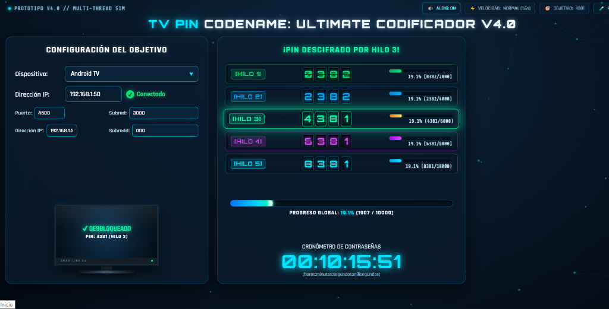

<div align="center">

```
╔══════════════════════════════════════════════════════════════╗
║   ████████╗██╗   ██╗    ██████╗ ██╗███╗   ██╗               ║
║      ██╔══╝██║   ██║    ██╔══██╗██║████╗  ██║               ║
║      ██║   ██║   ██║    ██████╔╝██║██╔██╗ ██║               ║
║      ██║   ╚██╗ ██╔╝    ██╔═══╝ ██║██║╚██╗██║               ║
║      ██║    ╚████╔╝     ██║     ██║██║ ╚████║               ║
║      ╚═╝     ╚═══╝      ╚═╝     ╚═╝╚═╝  ╚═══╝               ║
╚══════════════════════════════════════════════════════════════╝
```

# 🔐 TV PIN CODENAME: ULTIMATE CODIFICADOR `v4.0`

### 〔 **PROTOTIPO UI** 〕 · 〔 **MULTI-THREAD SIM** 〕 · 〔 **5 HILOS SIMULTÁNEOS** 〕

[](.)
[](.)
[](.)
[](.)

---

*Interfaz futurista de panel de ciberseguridad para simulación de auditoría de PINs en Smart TVs — diseño glassmorphism con 5 hilos de procesamiento en tiempo real.*

</div>

---

## 📸 Captura de Pantalla

<div align="center">



> *Vista del panel principal v4.0 — 5 hilos simultáneos en acción, PIN descifrado por Hilo 3*

</div>

---

## ✨ Características Principales

<table>
<tr>
<td width="50%">

### 🖥️ Panel de Configuración
- **Selector multimarca:** Android TV, Roku, Samsung Tizen, LG webOS
- **Entrada de IP** con indicador `✔ Conectado` interactivo
- **Maqueta de monitor TV** con animación de desbloqueo
- Campos de puerto, subred y dirección IP secundaria

</td>
<td width="50%">

### ⚡ Motor Multi-Thread v4.0
- **5 hilos simultáneos** de fuerza bruta independientes
- Cada hilo con **contador digital** y barra de progreso propia
- Detección y resaltado automático del **hilo ganador**
- Progreso global unificado con barra de degradado neón

</td>
</tr>
<tr>
<td>

### 🎨 Diseño Futurista
- Estética de **panel de ciberseguridad** oscuro
- Tipografía digital con **resplandor cian/verde**
- Paneles con efecto ***glassmorphism***
- Acentos en teal oscuro y brillo neón

</td>
<td>

### 📊 Monitoreo en Tiempo Real
- **Cronómetro de contraseñas** `HH:MM:SS:ms`
- Registro global de intentos por hilo
- Indicadores de velocidad: Normal (1.6x), Rápido, Turbo
- Display del PIN objetivo en barra superior

</td>
</tr>
</table>

---

## 🚀 Cómo Ejecutar

<div align="center">

```
┌─────────────────────────────────────────────────────────┐
│                   MÉTODOS DE INICIO                     │
└─────────────────────────────────────────────────────────┘
```

</div>

### 🥇 Opción 1 — Ejecutable Directo *(Ultra Recomendado)*

```
📁 OmniTVCracker/
└── 🖱️  OmniTVCracker.exe   ← Doble clic aquí
```
> Abre la interfaz en una **ventana de escritorio limpia** (sin barras del navegador) usando Chrome en modo app.

---

### 🥈 Opción 2 — Script de Lanzamiento

```powershell
# PowerShell
.\\launch.ps1

# O simplemente doble clic en:
launch.bat
```
> Inicia Chrome o Edge con la interfaz en modo aplicación independiente.

---

### 🥉 Opción 3 — Navegador Web Directo

```
📁 OmniTVCracker/
└── 🌐  index.html   ← Doble clic aquí
```
> Abre la interfaz en tu navegador predeterminado.

---

## 🎮 Controles & Interactividad

| Tecla / Control | ⚡ Acción |
|:---:|:---|
| `ESPACIO` | ▶️ Alternar **Iniciar / Pausar** todos los hilos |
| `R` | 🔄 **Detener y reiniciar** contador a `0000` |
| `Click en Conectado` | 📡 Simula **pérdida de enlace** de red |
| `Selector Dispositivo` | 📺 Cambia perfil y puertos automáticamente |
| `Botón VELOCIDAD` | 🚀 Alternar: **Normal** (1.5s) → **Rápido** (0.4s) → **Turbo** (40ms) |
| `Botón OBJETIVO` | 🎯 Configurar el **PIN exacto** para simular desbloqueo exitoso |
| `Botón AUDIO` | 🔊 Activar / desactivar **retroalimentación sonora** sintetizada |
| `Botón PANTALLA COMPLETA` | 🖥️ Expandir interfaz a **pantalla completa** |

---

## 📺 Dispositivos Soportados

| Plataforma | Puerto | Protocolo |
|:---:|:---:|:---:|
| 📱 **Android TV** | `5555` | ADB over TCP |
| 📺 **Roku** | `8060` | ECP (External Control) |
| 🌊 **Samsung Tizen** | `8002` | Smart View |
| ⚡ **LG webOS** | `3001` | Remote Access |

---

## 🏗️ Estructura del Proyecto

```
📦 OmniTVCracker/
├── 🌐  index.html          → Estructura principal de la UI
├── 🎨  style.css           → Estilos futuristas glassmorphism
├── ⚙️  app.js              → Motor multi-thread y lógica de simulación
├── 🖱️  OmniTVCracker.exe   → Lanzador de escritorio (sin navegador UI)
├── 📄  Launcher.cs         → Código fuente del lanzador (C#)
├── 📜  launch.bat          → Script de inicio (Windows Batch)
├── 💙  launch.ps1          → Script de inicio (PowerShell)
├── 🔗  TV PIN Ultimate Codificador.url
└── 📸  screenshot.png      → Captura de la interfaz v4.0
```

---

## ⚙️ Stack Tecnológico

<div align="center">


</div>

---

<div align="center">

```
━━━━━━━━━━━━━━━━━━━━━━━━━━━━━━━━━━━━━━━━━━━━━━
  ⚠️  AVISO LEGAL
━━━━━━━━━━━━━━━━━━━━━━━━━━━━━━━━━━━━━━━━━━━━━━
  Este software es un PROTOTIPO y SIMULADOR de
  interfaz gráfica de usuario con fines
  EDUCATIVOS, de diseño conceptual y pruebas
  de usabilidad. No realiza conexiones reales.
━━━━━━━━━━━━━━━━━━━━━━━━━━━━━━━━━━━━━━━━━━━━━━
```

*Made with 💙 · TV PIN Codename: Ultimate Codificador v4.0*

</div>
